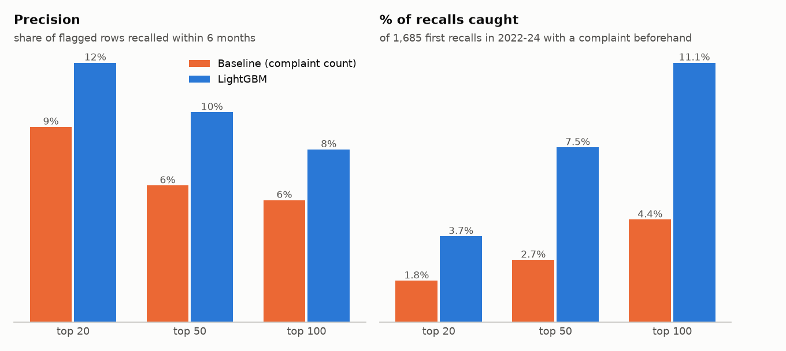
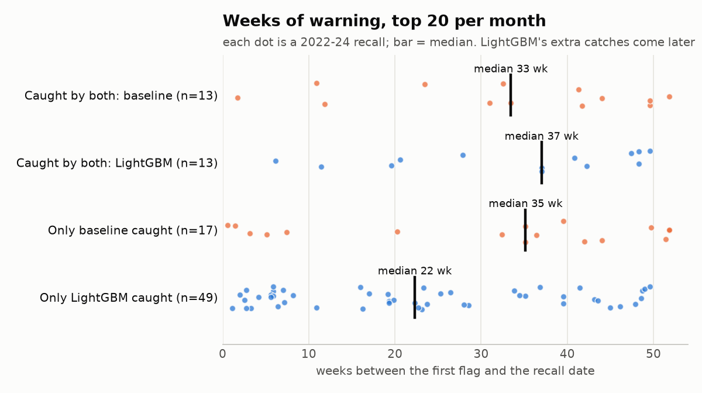
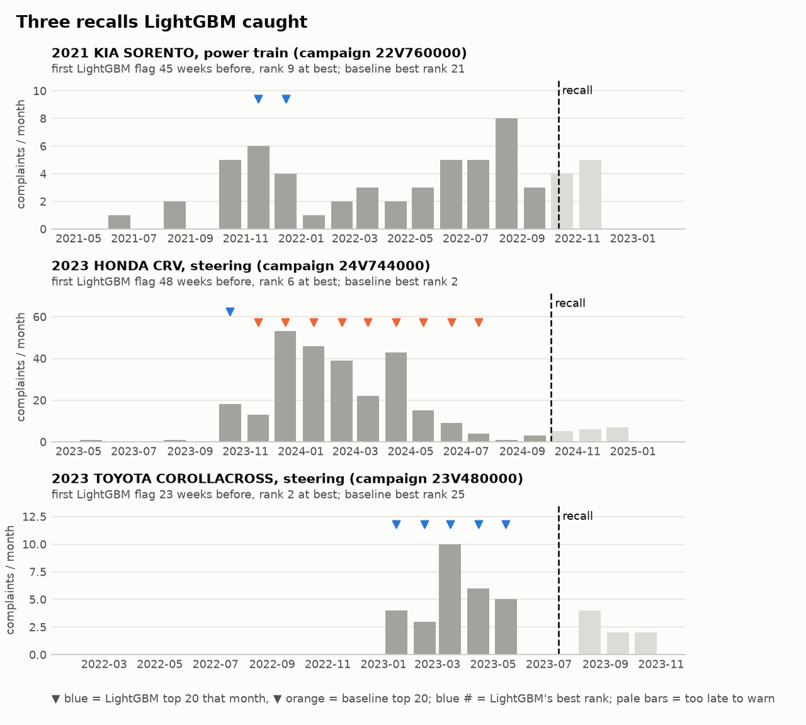
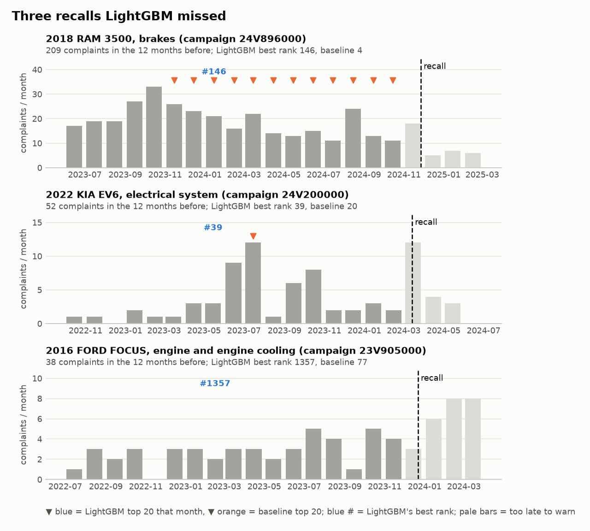

# Recall model: final results (clean data, test 2022-24)

Made by `python -m src.recall_model.results --source stg` from the rolling backtest in `model.py`
(refit every month on rows whose 6-month label was already known). Numbers are in
`recall_topk_stg.csv`, `recall_overlap_stg.csv`, `recall_miss_reasons_stg.csv`, `recall_cases_stg.csv`,
`recall_cases_monthly_stg.csv` and `recall_ablation_stg.csv`.

How we count:
- A recall is one car + part (make, model, model year, component) recalled on a date. One campaign
  covers many car + parts, so it can count more than once.
- **% of recalls caught** = share of the 1,685 first recalls in 2022-24 that had a complaint
  beforehand and were on the watchlist at some point in the 12 months before the recall. A car + part's
  complaints stop counting at its first recall, so later recalls can't be caught.
- **Precision** = share of watchlist rows that were recalled within 6 months.
- **Weeks of warning** = recall date minus the end of the first month the car + part was on the list.
- `UNKNOWN OR OTHER` is left out of the model and the watchlist (section 0). Its recalls still count
  as misses.

## 0. Change: `UNKNOWN OR OTHER` left out

`UNKNOWN OR OTHER` is the catch-all part. It was 65 of the 720 test watchlist rows (9%). It had 0
positive rows in 2022-24 (60 of 17,528 in all years), and only 149 of 220k recalls ever use it, so
those rows were never right and aren't something to investigate. It's now left out of training and
ranking (`SKIP_PARTS` in `model.py`), and the watchlist has none. Recalls with that part stay in the
denominators, so the metrics can't improve by dropping them.

Before vs. after, test 2022-24 (LightGBM refit from scratch, baseline re-ranked on the same rows):

| | Before | After |
|---|---|---|
| LightGBM precision @ 20 / 50 / 100 | 11.3% / 9.1% / 7.7% | **11.8% / 9.6% / 7.9%** |
| LightGBM % caught @ 20 / 50 / 100 | 3.9% / 7.2% / 10.1% | 3.7% / **7.5% / 11.1%** |
| LightGBM recalls caught @ 20 / 50 / 100 | 65 / 121 / 171 | 62 / **126 / 187** |
| LightGBM PR-AUC | 0.027 | **0.031** |
| Baseline precision @ 20 | 8.8% | 8.9% |
| Baseline PR-AUC | 0.013 | 0.016 |
| LightGBM validation (2020-21) precision@20 / PR-AUC | 6.5% / 0.023 | 7.1% / 0.027 |

- Precision and PR-AUC go up for both scorers and on the validation years too, because the 9% of
  slots that held a part that is never recalled now go to real parts.
- At top 20, LightGBM catches 3 fewer recalls (65 to 62). Run-to-run noise is about 1 point of
  precision, so this is within noise. At top 50 and 100 it catches 5 and 16 more.
- Weeks of warning barely move (median 23 at top 20 both times).

## 1. Final metric table: top 20, 50 and 100 per month

| List size | Scorer | Precision | Recalls caught | % of recalls caught | Median weeks of warning |
|---|---|---|---|---|---|
| top 20 | Baseline (3-month complaint count) | 8.9% | 30 | 1.8% | 35 |
| top 20 | **LightGBM** | **11.8%** | **62** | **3.7%** | 23 |
| top 50 | Baseline | 6.2% | 45 | 2.7% | 37 |
| top 50 | **LightGBM** | **9.6%** | **126** | **7.5%** | 26 |
| top 100 | Baseline | 5.6% | 74 | 4.4% | 37 |
| top 100 | **LightGBM** | **7.9%** | **187** | **11.1%** | 27 |

- PR-AUC over all test rows: LightGBM 0.031, baseline 0.016.
- LightGBM catches about 2-2.8x as many recalls as the baseline at every list size, and its precision
  is higher at every size.
- Going from 20 to 100 rows a month takes LightGBM from 3.7% to 11.1% caught. Precision drops from
  12% to 8%, so about 1 in 13 rows still turns into a recall.
- Counting every recall that had complaints since the last one (3,090), not just first recalls,
  LightGBM catches 2.0% / 4.1% / 6.1% at top 20 / 50 / 100 (baseline 1.0% / 1.5% / 2.4%).

## 2. Weeks of warning: why LightGBM's median (23) is lower than the baseline's (35)

The two scorers mostly catch **different** recalls, so their medians compare different groups.
On the recalls both caught, LightGBM warns earlier:

| Top 20 | Recalls | Median weeks, baseline | Median weeks, LightGBM |
|---|---|---|---|
| Caught by both | 13 | 33 | **37** (earlier on 8, same month on 1, later on 4) |
| Only baseline caught | 17 | 35 | – |
| Only LightGBM caught | 49 | – | 22 |

- The baseline only flags car + parts with lots of complaints. Those are slow, steady problems that
  stay near the top for a long time before a recall, so its warning times are long.
- LightGBM also catches 49 recalls the baseline never flags: new cars with a fast rise from a small
  number of complaints (see the Kia Sorento and Toyota Corolla Cross below). Those rises start closer to
  the recall, so the extra catches have shorter warning (median 22 weeks). That pulls the overall median
  down. It's extra recalls caught, not later warnings on the same recalls.
- Same pattern at bigger lists. At top 100, of the 53 caught by both, LightGBM is earlier on 29, the
  same month on 18 and later on 6 (median 38 vs 34 weeks).

## 3. SHAP reasons in the watchlist

Already in: `top_reasons` in `watchlist_stg.csv` / `main.watchlist` are the 3 features that pushed each
row's score up the most, from the SHAP values of the model that scored that month, written as plain
facts. All 720 test rows (36 months x 20) have SHAP values and 3 reasons, e.g.
`143 complaints in the last 12 months; vehicle is 3 years old; 8 complaints saying it happened without warning in the last 3 months`.
Note for the agent: "vehicle is under a year old" is often the top reason, because new cars get recalled
more (section 7). It's context, not a defect sign.

## 4. Charts for the write-up

1. `recall_topk_stg.png`: precision and % of recalls caught at top 20 / 50 / 100 (above)
2. `recall_warning_compare_stg.png`: weeks of warning, caught by both vs. by only one scorer (above)
3. `recall_cases_caught_stg.png` and `recall_cases_missed_stg.png`: complaints per month for the
   case studies below
4. Already there: `recall_shap_summary_stg.png` (what moves the score) and `recall_warning_weeks_stg.png`

## 5. Three recalls the model caught

Complaints per month, each scorer's rank in every month that could have warned, and the recall date for
all six cases are in `recall_cases_monthly_stg.csv`. First flag dates are in `recall_cases_stg.csv`.

**2021 Kia Sorento, power train, campaign 22V760000, recalled 2022-10-11.** A transmission oil pump
fault can cause a complete loss of drive power. A burst of 5-6 complaints a month started in Oct
2021 on a car under a year old. LightGBM put it on the list in **Nov 2021, 45 weeks before the
recall** (best rank 9). The baseline never had it in the top 20 (best rank 21). Watchlist reasons at the
first flag: *vehicle is under a year old; 14 complaints in the last 12 months; 6 complaints saying it
happened without warning in the last 3 months*.

**2023 Honda CR-V, steering, campaign 24V744000, recalled 2024-10-03.** One of the biggest complaint
spikes in the test years. Complaints jumped from 0-1 a month to 18 in Oct 2023 and peaked at 53 in December. LightGBM put it
at **#6 in Oct 2023, 48 weeks before the recall**, a month before the baseline (Nov 2023, 44 weeks).
Reasons: *vehicle is under a year old; 20 complaints in the last 12 months; 20 complaints in the last
6 months*. LightGBM reacts to the onset and then drops it as the count settles high. The baseline
keeps it on the list for 9 months. The two complement each other.

**2023 Toyota Corolla Cross, steering, campaign 23V480000, recalled 2023-07-12.** A badly welded
connection in the steering column's spiral cable. Only 4 complaints in its first month (Jan 2023), and
LightGBM put it on the list right away (**23 weeks before**, best rank 2) and kept it there for 5
months. The baseline never had it in the top 20 (best rank 25). Reasons: *vehicle is under a year old;
4 complaints in the last 12 months; 4 complaints in the last 6 months*.

## 6. Three misses and why

LightGBM missed 1,623 of the 1,685 first recalls at top 20. Most never had much to go on:

| Why missed (top 20) | Recalls | Share |
|---|---|---|
| No complaints in the 12 months before | 522 | 32% |
| 1-2 complaints in the 12 months before | 719 | 44% |
| 3+ complaints, best rank 21-100 (a bigger list catches these) | 102 | 6% |
| 3+ complaints, never in the top 100 | 280 | 17% |

So about three quarters of recalls have almost no complaint signal in the year before. Those are
often found by the maker's own testing or warranty data, which we don't have.

**2018 Ram 3500, brakes, campaign 24V896000, recalled 2024-11-27. Lots of complaints, but steady.** The
ABS hydraulic control unit can fail. There were 209 complaints in the year before, and the baseline had
it in the top 20 every month for 12 months. LightGBM's best was #146 (Jan 2024, score 0.46 vs. 0.62
needed for top 20). SHAP at that month: the 247 complaints in the last 12 months (+1.97) and the
6-year-old truck (+0.95) pushed it up, and nothing pushed it down much (the biggest was -0.15). Our
reading: complaints were high but flat or falling (the last 3 months at 1.2x the prior 9), and in
training, steady high counts on older trucks usually didn't lead to a recall within 6 months.
The 2018 Ram 2500 in the same campaign *was* caught (47 weeks).

**2022 Kia EV6, electrical system, campaign 24V200000, recalled 2024-03-14. Just outside the list.** The
same charging-unit (ICCU) failure as the Hyundai Ioniq 5, which can cause a loss of drive power.
Complaints rose from 1-3 a month to 9 and 12 in June-July 2023. LightGBM had it at #39-52 for three
months (best 0.585 vs. 0.61 needed). The baseline had it at #20 for one month (July 2023). A top 50
list catches it with LightGBM **41 weeks before the recall**. The
2022 and 2023 Ioniq 5 in the Hyundai campaign for the same failure were caught at top 20 (37 weeks).

**2016 Ford Focus, engine, campaign 23V905000, recalled 2023-12-22. A slow trickle.** The oil pump drive
belt can fail and cause a loss of oil pressure. There were 2-5 complaints a month for 18 months on a 7-year-old car,
with no rise. LightGBM's best rank was #1,357 (score 0.26 vs. 0.63) and the baseline's #77, so
neither caught it at any list size up to 100. The same campaign's 2018 Ford EcoSport, whose complaints
rose faster, was caught (21 weeks).

## 7. Vehicle age vs. complaints

`vehicle_age` carries about two thirds of v1's gain, so we ran the same rolling backtest (same split,
settings and monthly refits) with an **age-only** model (`vehicle_age`) and a **complaints-only** model
(every v1 feature except `vehicle_age` and `median_miles_12m`, since miles at complaint stand in for
age). `python -m src.recall_model.ablation --source stg`, numbers in `recall_ablation_stg.csv`.

| Model | Precision @ 20 / 100 | Recalls caught @ 20 / 100 | % caught @ 20 / 100 | PR-AUC |
|---|---|---|---|---|
| Baseline (3-month complaint count) | 8.9% / 5.6% | 30 / 74 | 1.8% / 4.4% | 0.016 |
| Age only | 7.6% / 6.5% | 35 / 129 | 2.1% / 7.7% | 0.026 |
| Complaints only | 6.4% / 5.4% | 41 / 139 | 2.4% / 8.2% | 0.017 |
| **v1 (complaints + age)** | **11.8% / 7.9%** | **62 / 187** | **3.7% / 11.1%** | **0.031** |

- **Neither half is close to v1 alone.** At top 20, v1 catches 62 recalls vs. 35 (age only) and 41
  (complaints only), with much higher precision (11.8% vs. 7.6% and 6.4%).
- **Age picks the pool, complaints pick within it.** Age alone gets 7.6% precision just by listing new
  cars: a car + part with complaints in its first model year is often recalled. 76% of v1's top-20 rows
  are cars of the current or next model year. Among those, v1 uses complaints to decide *which* ones,
  and that's where the gain over age alone comes from.
- **Complaints without age are no better than counting complaints.** The complaints-only model's
  precision is no higher than the baseline's (6.4% vs. 8.9% at top 20, 5.4% vs. 5.6% at top 100),
  though it catches a few more recalls. The extra features only pay off together with age.
- So `vehicle_age`'s large gain share doesn't mean complaints don't matter. Without complaints, v1
  would lose 27 of its 62 catches at top 20 and a third of its precision.

A note on "% caught". Every car + part of the same age gets the same age-only score, so the ties have to
be broken. A fixed random order per car + part is used above. With a *new* random order every month,
age only reached 79 caught at top 20, because the list reshuffled and touched 514 different car + parts
(v1: 365, baseline: 125). % caught rewards a list that changes a lot from month to month, and precision
doesn't, so the two are reported together. This also accounts for part of v1's lead over the baseline on
recalls caught, but v1 leads on precision too.
